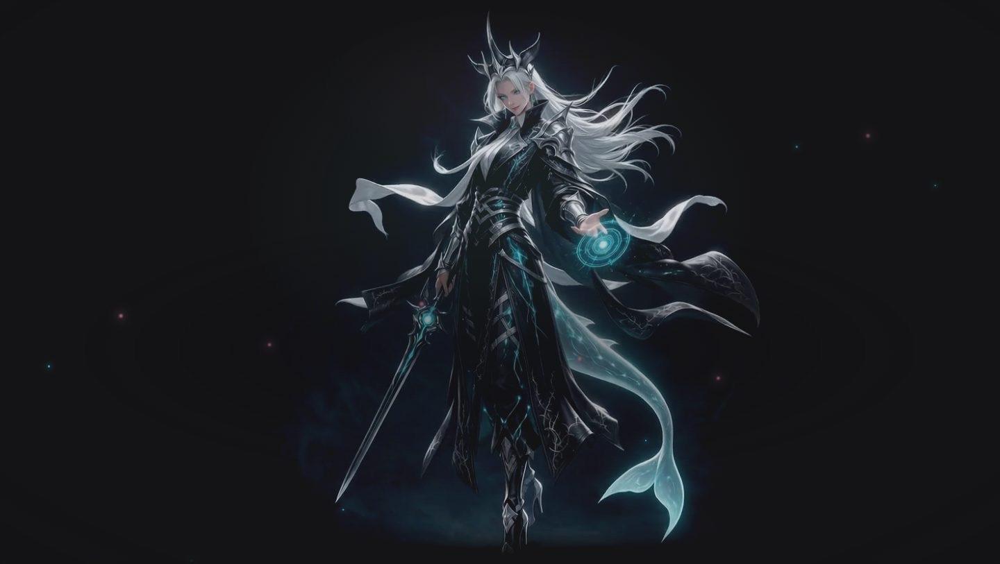

# DeepSeek Harness 桌面版皮肤（macOS）

非官方的 [DeepSeek Harness](https://github.com/deepseek-ai/deepseek-harness) 桌面版皮肤：启动时的入场动画，加上新会话首页的动态骑士背景。它以外部插件的形式加载，不修改、不重新签名官方 App，官方自动更新照常进行。



## 效果

- **入场动画**：官方主页面载入时播放，共 18 秒，前 12 秒是入场，后 6 秒在等待加载时循环。左侧按本机时间打出问候语和一句随机台词，左下角显示载入状态。单击、点「跳过」或按 Esc 可以跳过，最迟 25 秒自动移除。
- **首页背景**：只在新会话首页出现。3D 渲染的银发骑士，掌心法阵实时绘制、各层分别旋转，背景有漂浮的光点。四段动作随机播放（待机、睥睨抬眸、剑锋微转、魔力涌动），下一段只保证和正在播放的不同；段与段之间按帧衔接，没有停顿。
- 系统开启「减少动态效果」时，不播放入场动画和背景视频，只显示静态海报和静止的法阵。
- 默认暗色主题；如果你在设置里明确选过主题，以你的选择为准。

## 要求

- macOS 与官方 DeepSeek Harness 桌面版，已验证 0.2.0-rc.2。安装前至少打开过一次 App 并完成初次设置。
- 系统自带的 `python3`。

## 安装

下载或克隆本仓库，然后任选一种方式：

- 双击 `安装皮肤.command`。如果 macOS 提示无法打开，改用下面的终端命令。
- 在终端里进入仓库目录运行：

```sh
python3 install.py
python3 install.py --name 你的称呼   # 入场问候语带上称呼，例如「小明，早上好。」
```

装好后退出并重新打开 DeepSeek Harness。不传 `--name` 时问候语不带称呼；以后再运行 `install.py` 会保留已有的称呼，传 `--name ""` 可以取消。更新皮肤时拉取新版本后重新运行 `install.py` 即可。

安装位置是 `~/Library/Application Support/DeepSeekAnimations/`：

- `plugin/`：实际加载的插件文件。
- `plugin-recovery.zip`、`recovery-manifest.json`：安装时打包的修复源和 SHA-256 清单。
- `config.json`：问候语里的称呼，修复时不会被覆盖。
- `health.json`：本机运行记录，只有进程号、启动时间和动画事件时间。

脚本只改 `~/.dsh/profiles/desktop/package.json` 里本插件的依赖和 bundle 两项（第一次改动前另存为 `package.json.before-yoren-animations`），再建一个指向插件目录的链接。不创建定时任务、LaunchAgent 或后台进程。

## 检查与修复

```sh
python3 "$HOME/Library/Application Support/DeepSeekAnimations/restore.py"            # 只检查
python3 "$HOME/Library/Application Support/DeepSeekAnimations/restore.py" --repair   # 修复
```

`--repair` 只修复本插件的文件和注册，不动其他设置、凭据和会话。输出 `restart_needed: true` 时，在方便时退出并重新打开 DeepSeek Harness。官方更新通常只替换 App，插件在 App 之外，正常升级后仍然有效；如果新版改了插件接口或首页结构，需要另行适配。

## 卸载

从 `~/.dsh/profiles/desktop/package.json` 的 `dependencies` 删除 `@yoren/dsh-animations`，从 `dsh.profile.bundles` 删除同名条目，再删除 `~/.dsh/profiles/desktop/node_modules/@yoren/dsh-animations` 链接，然后重启 App。不再需要时，可以把 `~/Library/Application Support/DeepSeekAnimations/` 移到废纸篓。

## 工作原理

插件通过官方桌面版的 Cordis 插件机制加载：注册 `/yoren-animations/` 路由，提供脚本、样式和媒体（支持 HTTP Range），并在 `webserver/index-inject` 时把样式和脚本注入主页面。入场动画是盖在页面上的 iframe；首页背景在出现 `[data-conversation-content][data-content-phase="hero"]` 时挂载，离开首页即移除，对辅助功能树隐藏，也不响应指针。

首页四段视频的首尾都停在同一个姿势（海报帧）。两个 video 元素交替缓冲：下一段提前定位到首个有效帧并解码好；当前一段播到最后有效帧前 2 帧时启动下一段，用 `requestVideoFrameCallback` 逐帧计时（不支持时退回 `timeupdate`）；新的一段 0.2 秒线性淡入，旧的一段停在相同姿势垫底。每段只播有效帧（24fps 帧号）：

| 文件 | 动作 | 播放帧 |
|---|---|---|
| `idle.mp4` | 待机 | 1–144 |
| `wink.mp4` | 睥睨抬眸 | 1–120 |
| `lean.mp4` | 剑锋微转 | 4–98 |
| `toss.mp4` | 魔力涌动 | 1–125 |

每段的第 0 帧和上一段的最后一帧是同一个姿势，所以跳过；剑锋微转、魔力涌动结尾原本有将近一秒完全静止，在静止开始处交接。换成自己的视频时，要逐帧重新测量，并更新 `src/hero-runtime.ts` 里的 `CLIPS`。

## 开发

```
plugin/      实际安装的插件（client.js 由 src/ 生成，不要直接改）
src/         首页背景运行时 hero-runtime.ts 与页面接线 client-tail.js
scripts/     build-client.mjs：去掉 TypeScript 类型后拼成 plugin/client.js
test/        插件路由、注入、问候语和构建一致性测试
install.py   安装与更新；restore.py 检查与修复
```

需要 Node.js 22.13 或更高版本（用到 `module.stripTypeScriptTypes`）：

```sh
npm run build   # 改过 src/ 后重新生成 plugin/client.js
npm test
```

## 素材与致谢

- 素材均由作者用生成式 AI 制作：原画由火山引擎生图绘制，首页骑士的 3D 重绘与动作片段由 Seedream / Seedance 生成。
- 鲸鱼娘形象参考社区项目 [TreapGoGo/deepseek-whale-girl](https://github.com/TreapGoGo/deepseek-whale-girl)（MIT）。

本项目与 DeepSeek 官方无关，不代表 DeepSeek 立场。

## 许可

[MIT](LICENSE) © 2026 YorenZZZ
